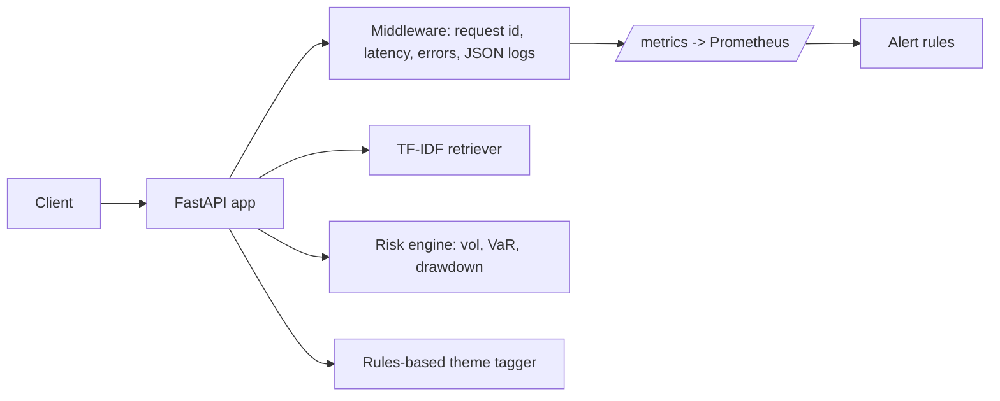

# FinRisk Service

A small, observable API that answers two questions together: **what risks do companies disclose?** (retrieval over risk-factor passages) and **how risky do their shares actually look?** (historical volatility, 1-day 95% VaR, max drawdown). A `/screen` endpoint joins the two, e.g. *"which companies flag supply-chain risk AND have annualised volatility above 30%?"*

> **All data is synthetic.** Companies are fictional (Northwind Freight, Helix Biologics, ...), passages are hand-written, and prices are seeded random walks (`scripts/make_prices.py`). Nothing here is investment information. Swap in real filings and closes to use it for real.

## Architecture



## Endpoints

| Endpoint | Purpose |
|---|---|
| `GET /search?q=&k=&ticker=&theme=` | Ranked risk-factor passages with cosine score and themes |
| `GET /risk/{ticker}` | Annualised volatility, 95% 1-day historical VaR, max drawdown |
| `GET /screen?theme=&min_vol=` | Companies flagging a risk theme, joined to volatility and VaR |
| `GET /health` | Liveness and data counts |
| `GET /metrics` | Prometheus metrics |

## Evaluation (measured, `python -m app.eval`)

20 hand-labelled queries (one relevant passage each) over 24 passages:

| Recall@1 | Recall@3 | Recall@5 | MRR |
|---|---|---|---|
| 0.75 | 0.90 | 0.90 | 0.825 |

This is a **small synthetic benchmark**: use it as a regression gate (CI fails if Recall@5 < 0.85 or MRR < 0.80), not as evidence of real-world accuracy. Misses are written to `eval_results.json`; vocabulary-mismatch queries ("customers cancelling subscriptions" vs "churn") fail because TF-IDF has no semantics, which is the motivation for the embedding backend below.

## Monitoring

- **Metrics:** request count by route/status, latency histogram, unhandled-error counter, top-1 retrieval score histogram, low-confidence search counter.
- **Logs:** one structured JSON line per request with `request_id`, route, status and `latency_ms`; `x-request-id` is echoed in responses for tracing.
- **Alerts** (`prometheus/alerts.yml`): error rate > 5%, p95 latency > 500 ms, and retrieval-quality drift (> 30% of searches with low top-1 confidence).

## Run it

```bash
pip install -r requirements-dev.txt
pytest -q                      # 16 tests
python -m app.eval             # retrieval metrics
uvicorn app.main:app --reload  # http://localhost:8000/docs

docker compose up --build      # API on :8000, Prometheus on :9090
```

## SageMaker model serving

The retriever is also packaged as an Amazon SageMaker scikit-learn inference endpoint (`sagemaker/`):

- `inference.py`: SageMaker handler (`model_fn`, `input_fn`, `predict_fn`, `output_fn`). The model archive holds the tagged passages and the TF-IDF index is fitted at container start, which avoids scikit-learn pickle incompatibilities between local and container versions.
- `package_model.py`: builds `model.tar.gz`.
- `deploy_local.py`: deploys with **SageMaker local mode** (AWS's official `sagemaker-scikit-learn` container running in Docker) and checks result parity against the API's retriever.

```bash
pip install "sagemaker[local]>=2.230,<3"
python sagemaker/package_model.py
python sagemaker/deploy_local.py   # 3/3 queries match the API (same tickers and scores)
```

Validated in local mode only (no AWS charges). Switching `instance_type` and uploading the archive to S3 deploys it to SageMaker for real.

## Cloud deployment

See [DEPLOY.md](DEPLOY.md) for AWS steps (ECR, CloudWatch logs and alarms, teardown). Note: AWS App Runner closed to new customers on 30 April 2026; new accounts should use ECS Express Mode or Lambda instead.

## Limitations and roadmap

- Retriever is TF-IDF; next step is embeddings + pgvector behind the same `search()` interface, compared on the same eval set.
- Theme tagger is keyword rules: transparent and auditable, but not exhaustive.
- VaR is plain historical simulation on one asset at a time; no portfolio aggregation, no backtest.
- Ingest real filings (SEC EDGAR 10-K Item 1A) and real prices to replace the synthetic data.
